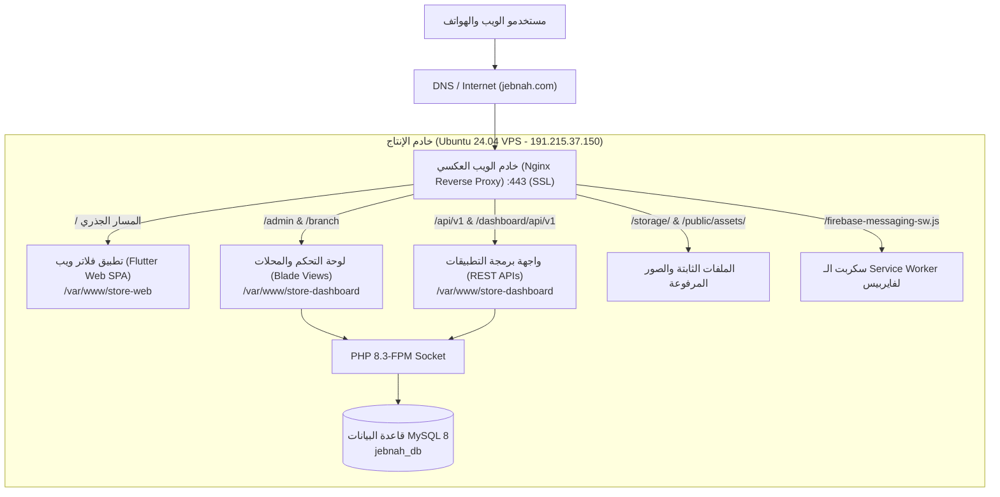
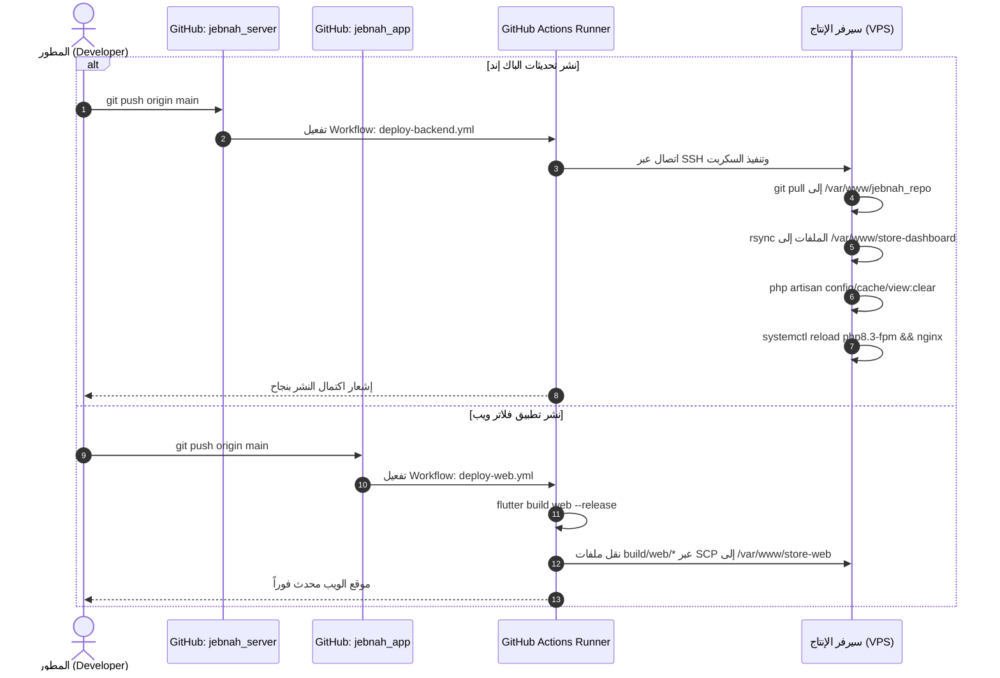

# 📘 دليل التوثيق والتشغيل الشامل لنظام جبنة (Jebnah System Manual)
## دليل البنية التحتية، خوادم الإنتاج، وخطوط النشر الآلي (CI/CD)

---

> [!NOTE]
> هذا الدليل مُعد خصيصاً لفريق الدعم الفني، مديري الأنظمة (DevOps/SysAdmin)، والمطورين المسؤولين عن تشغيل وصيانة وتطوير نظام **جبنة (Jebnah)**. يحتوي على التفاصيل المعمارية، إعدادات الخادم، خطوط النشر، ودليل استكشاف الأخطاء الشائعة وحلها.

---

## 📑 فهرس المحتويات
1. [نظرة عامة على البنية المعمارية (System Architecture)](#1-نظرة-عامة-على-البنية-المعمارية)
2. [بيانات وبيئة خادم الإنتاج (Production VPS Environment)](#2-بيانات-وبيئة-خادم-الإنتاج)
3. [هيكلية توجيه المسارات الموحدة عبر Nginx](#3-هيكلية-توجيه-المسارات-الموحدة-عبر-nginx)
4. [مستودعات الكود وخطوط النشر الآلي (CI/CD Pipelines)](#4-مستودعات-الكود-وخطوط-النشر-الآلي)
   - [خط نشر الباك إند (Laravel Backend Pipeline)](#أ-خط-نشر-الباك-إند-laravel-backend)
   - [خط نشر تطبيق الويب (Flutter Web Pipeline)](#ب-خط-نشر-تطبيق-الويب-flutter-web)
   - [خط بناء تطبيق الأندرويد (Android APK Pipeline)](#ج-خط-بناء-تطبيق-الأندرويد-android-apk)
5. [إدارة الأسرار والمتغيرات البيئية (GitHub Secrets)](#5-إدارة-الأسرار-والمتغيرات-البيئية)
6. [إعدادات وتكامل إشعارات Firebase (FCM Configuration)](#6-إعدادات-وتكامل-إشعارات-firebase)
7. [دليل الصيانة الدورية واستكشاف الأخطاء (Troubleshooting Runbook)](#7-دليل-الصيانة-الدورية-واستكشاف-الأخطاء)
8. [إجراءات النسخ الاحتياطي والاستعادة (Backup & Recovery)](#8-إجراءات-النسخ-الاحتياطي-والاستعادة)

---

## 1. نظرة عامة على البنية المعمارية

يعتمد نظام **جبنة** على معمارية النطاق الموحد متعدد المسارات (**Single Domain, Multi-Path Architecture**)، حيث تتم خدمة جميع مكونات النظام تحت اسم النطاق الأساسي `https://jebnah.com` دون الحاجة إلى نطاقات فرعية، مما يمنع مشاكل مشاركة الكوكيز (Cross-Domain Cookies) ومشاكل طلبات النطاقات المتعددة (CORS).



---

## 2. بيانات وبيئة خادم الإنتاج

| الخاصية | القيمة | ملاحظات |
| :--- | :--- | :--- |
| **مزود الاستضافة** | Hostinger VPS | كفالة اتصال بسرعة 1 Gbps |
| **نظام التشغيل** | Ubuntu 24.04 LTS (Noble Numbat) | 64-bit |
| **عنوان الـ IP** | `191.215.37.150` | ثابت (Static IP) |
| **مستخدم النظام** | `root` | صلاحيات كاملة |
| **خادم الويب** | Nginx 1.24.0 | مزود بشهادة Let's Encrypt SSL صالحة وتتجدد تلقائياً |
| **بيئة التشغيل** | PHP 8.3-FPM | مع إضافات: `pdo_mysql`, `curl`, `mbstring`, `xml`, `gd`, `zip`, `intl` |
| **محرك قاعدة البيانات** | MySQL 8.0 | اسم القاعدة: `jebnah_db`، المستخدم: `root` |
| **الذاكرة الافتراضية (Swap)** | 2.0 GB Swap File (`/swapfile`) | مفعل لحماية النظام من نفاد الذاكرة الفجائي (OOM) |
| **مسار تطبيق فلاتر ويب** | `/var/www/store-web/` | الصلاحيات: `root:root` (قراءة عامة 755) |
| **مسار لوحة التحكم والباك إند** | `/var/www/store-dashboard/` | الصلاحيات: مجلد التخزين `storage` مملوك لـ `www-data:www-data` |
| **مستودع الكود المحلي للـ CI/CD** | `/var/www/jebnah_repo/` | مستودع Git مستقل يستقبل التحديثات قبل مزامنتها |

---

## 3. هيكلية توجيه المسارات الموحدة عبر Nginx

يتم توجيه حركة المرور عبر ملف إعداد Nginx الموجود في المسار:
`/etc/nginx/sites-available/jebnah` (المرتبط رمزياً مع `/etc/nginx/sites-enabled/jebnah`).

### جدول قواعد التوجيه:

| المسار المطلوب (Request URI) | الوجهة (Target Handler) | نوع المحتوى المُعاد | الغرض |
| :--- | :--- | :--- | :--- |
| `/` و المسارات الفرعية العامة | `/var/www/store-web/` | `text/html` (Single Page App) | متجر فلاتر ويب للعملاء |
| `/admin` أو `/admin/*` | Laravel PHP-FPM (`store-dashboard/public`) | `text/html` | لوحة تحكم الإدارة العامة |
| `/branch` أو `/branch/*` | Laravel PHP-FPM (`store-dashboard/public`) | `text/html` | لوحات تحكم الفروع |
| `/api/v1/*` | Laravel API Routes (`store-dashboard/public`) | `application/json` | واجهات برمجة التطبيقات لتطبيق الجوال |
| `/dashboard/api/v1/*` | Laravel API Routes (`store-dashboard/public`) | `application/json` | مسار بديل متوافق مع لوحة التحكم |
| `/storage/app/public/*` | `/var/www/store-dashboard/storage/app/public/` | Images / Files | وسائط وصور المنتجات والمتاجر |
| `/storage/app/public/admin/` | `/assets/admin/img/160x160/img1.jpg` | `image/jpeg` (Rewrite 200) | صورة افتراضية للمدير في حال عدم رفع صورة |
| `/firebase-messaging-sw.js` | `/var/www/store-dashboard/public/` | `application/javascript` | استقبال إشعارات Firebase Web Push |

> [!IMPORTANT]
> عند تعديل ملف إعدادات Nginx، يجب دائماً فحص سلامة القواعد قبل إعادة التشغيل عبر الأمر:
> `nginx -t && systemctl reload nginx`

---

## 4. مستودعات الكود وخطوط النشر الآلي

يتكون النظام من مستودعين رئيسيين على GitHub، ولكل منهما Pipeline مستقل يعمل عبر **GitHub Actions**:



---

### أ. خط نشر الباك إند (Laravel Backend)

* **المستودع**: [`git@github.com:OmarBinzager/jebnah_server.git`](https://github.com/OmarBinzager/jebnah_server)
* **الفرع المعتمد**: `main`
* **ملف الـ Workflow**: [`.github/workflows/deploy-backend.yml`](file:///c:/Users/Dev.OmarBinzager/Desktop/Projects/WINCODE/jebnah_server/.github/workflows/deploy-backend.yml)
* **زمن التنفيذ المعتاد**: 12 - 18 ثانية.

#### خطوات العمل في الـ Pipeline:
1. يتم تفعيل السير تلقائياً عند أي `push` على فرع `main`.
2. يتصل الـ Action بالسيرفر عبر بروتوكول SSH مشفر.
3. يدخل لمستودع الكود المرجعي `/var/www/jebnah_repo` ويقوم بسحب آخر التعديلات بسرعة شبكة السيرفر العالية (1 Gbps) عبر:
   ```bash
   git pull origin main
   ```
4. يقوم بأمر `rsync` لمزامنة الأكواد الجديدة مع مجلد التشغيل `/var/www/store-dashboard/` مع **الحفاظ التام** على الملفات الحساسة الخاصة بالإنتاج:
   - ملف البيئة `.env` (لا يتم استبداله أبداً).
   - مجلد وسائط التخزين `storage/` ومجلد المكتبات `vendor/`.
5. ينفذ أوامر تنظيف الكاش وإعادة بناء التكوين:
   ```bash
   php artisan config:clear
   php artisan cache:clear
   systemctl reload php8.3-fpm
   systemctl reload nginx
   ```

---

### ب. خط نشر تطبيق الويب (Flutter Web)

* **المستودع**: [`git@github.com:OmarBinzager/jebnah_app.git`](https://github.com/OmarBinzager/jebnah_app)
* **الفرع المعتمد**: `main`
* **ملف الـ Workflow**: [`.github/workflows/deploy-web.yml`](file:///c:/Users/Dev.OmarBinzager/Desktop/Projects/WINCODE/jebnah/.github/workflows/deploy-web.yml)
* **زمن التنفيذ المعتاد**: 2.5 - 3.5 دقيقة.

#### خطوات العمل في الـ Pipeline:
1. تجهيز بيئة التشغيل على خوادم GitHub بتثبيت إطار عمل Flutter (القناة المستقرة Stable).
2. تثبيت الحزم المطلوبة: `flutter pub get`.
3. بناء نسخة الإنتاج الخاصة بالويب:
   ```bash
   flutter build web --release --base-href "/"
   ```
4. نقل محتويات مجلد البناء `build/web/*` إلى خادم الـ VPS في المسار `/var/www/store-web/` باستخدام `appleboy/scp-action`.
5. استخدام التوثيق المزدوج (SSH Key + Password Fallback) لضمان عدم فشل الاتصال مطلقاً.

---

### ج. خط بناء تطبيق الأندرويد (Android APK)

* **المستودع**: [`git@github.com:OmarBinzager/jebnah_app.git`](https://github.com/OmarBinzager/jebnah_app)
* **ملف الـ Workflow**: [`.github/workflows/build-android.yml`](file:///c:/Users/Dev.OmarBinzager/Desktop/Projects/WINCODE/jebnah/.github/workflows/build-android.yml)
* **طريقة التشغيل**: **يدوي عند الطلب فقط (Workflow Dispatch)** من تبويب Actions على GitHub.

#### كيفية تشغيل بناء الـ APK واستخراجه:
1. التوجه لمستودع `OmarBinzager/jebnah_app` على GitHub.
2. النقر على تبويب **Actions**.
3. اختيار الـ Workflow المسمى: **`Build Android Release APK`**.
4. النقر على زر **`Run workflow`** واختيار الفرع `main`.
5. بعد انتهاء البناء (~5 دقائق)، ستجد ملف التطبيق جاهزاً للتحميل تحت قسم **Artifacts** باسم `app-release.zip` وبداخله `app-release.apk`.

---

## 5. إدارة الأسرار والمتغيرات البيئية

تم ضبط الأسرار الأمنية التالية في كلا المستودعين (`jebnah_server` و `jebnah_app`) تحت **Settings -> Secrets and variables -> Actions**:

| اسم السر (Secret Name) | الغرض | القيمة / الوصف |
| :--- | :--- | :--- |
| `VPS_HOST` | عنوان خادم الإنتاج | `191.215.37.150` |
| `VPS_USER` | اسم مستخدم SSH | `root` |
| `VPS_PASSWORD` | كلمة مرور السيرفر | كلمة مرور حساب root المشفرة |
| `VPS_SSH_KEY` | مفتاح الاتصال الخاص | مفتاح OpenSSH Deploy Key مخصص لعمليات الأتمتة |

> [!TIP]
> في حال تم تغيير كلمة مرور السيرفر أو تجديد مفاتيح الـ SSH، يمكن تحديث الأسرار في المستودعين دفعة واحدة من الجهاز المحلي باستخدام أداة `gh` عبر تشغيل السكربت الموجود في المشروع:
> `python check_fcm_db.py` أو عبر أوامر `gh secret set <NAME> -R <REPO>`.

---

## 6. إعدادات وتكامل إشعارات Firebase

تعتمد لوحة التحكم وتطبيقات الجوال على **Firebase Cloud Messaging (FCM)** لإرسال تنبيهات الطلبات الجديدة وإشعارات التوصيل:

1. **إعدادات الواجهة الأمامية (Web Frontend)**:
   - تم حفظ ملف `firebase-messaging-sw.js` في مجلدين:
     - `/var/www/store-dashboard/public/` (يخدمه Nginx مباشرة).
     - `/var/www/store-web/` (ضمن تطبيق فلاتر ويب).
   - يتم التعرف عليه برأس `application/javascript` بدون تخزين مؤقت.
2. **إعدادات الواجهة الخلفية (Backend Service Provider)**:
   - ملف المزود: `app/Providers/FirebaseServiceProvider.php`.
   - يتم قراءة بيانات الحساب الآلي (Service Account JSON) من جدول `business_settings` (المفتاح `push_notification_service_file_content`).
   - يدعم المزود كلاً من التنسيق المباشر (Direct Object) وتنسيق المصفوفات الفرعية (`service_file_content`).
   - عند طلب الاشتراك بالمسار `/subscribeToTopic`، يتم تسجيل الجهاز في مجموعة `grofresh_admin_message` بكود `200 OK`.

---

## 7. دليل الصيانة الدورية واستكشاف الأخطاء

### أهم أوامر الفحص والتشخيص السريع على السيرفر:

```bash
# 1. التحقق من حالة خادم الويب Nginx
systemctl status nginx

# 2. التحقق من حالة معالج PHP-FPM
systemctl status php8.3-fpm

# 3. التحقق من حالة قاعدة البيانات MySQL
systemctl status mysql

# 4. مراقبة استهلاك الموارد والذاكرة والـ Swap
free -h
htop

# 5. تنظيف كافة كاشات لارافيل وتحديث القوالب
cd /var/www/store-dashboard
php artisan config:clear
php artisan cache:clear
php artisan view:clear
php artisan route:clear
systemctl reload php8.3-fpm

# 6. فحص سجلات أخطاء Nginx المباشرة
tail -n 50 /var/log/nginx/error.log

# 7. فحص سجلات أخطاء لارافيل المباشرة
tail -n 50 /var/www/store-dashboard/storage/logs/laravel.log
```

---

### جدول المشاكل الشائعة وكيفية التعامل معها:

| العَرَض (Symptom) | السبب المحتمل (Probable Cause) | الإجراء والحل (Resolution) |
| :--- | :--- | :--- |
| **ظهور خطأ 502 Bad Gateway** | توقف خدمة PHP-FPM أو انهيارها | قم بتشغيل: `systemctl restart php8.3-fpm` وفحص `/var/log/php8.3-fpm.log`. |
| **خطأ 419 Page Expired في اللوحة** | انتهاء جلسة الـ CSRF أو امتلاء مساحة القرص | تأكد من وجود مساحة في القرص عبر `df -h`، ثم أعد تشغيل `php8.3-fpm`. |
| **عدم ظهور الصور المرفوعة حديثاً** | فقدان صلاحيات مجلد `storage` | شغّل الأمر:<br>`chown -R www-data:www-data /var/www/store-dashboard/storage`<br>`chmod -R 775 /var/www/store-dashboard/storage` |
| **رسالة `$ is not defined` في الـ Console** | تفعيل `APP_DEBUG=true` أو ترتيب سكربتات خاطئ | تأكد من أن `APP_DEBUG=false` في ملف `.env`، وأن السكربتات المخصصة تستخدم `@push('script_2')`. |
| **فشل الـ Pipeline في خطوة SSH/SCP** | تفعيل جدار حماية استضافة Hostinger ضد الـ Brute Force | تجنب المحاولات المتكررة بكلمات مرور خاطئة؛ الأسرار مجهزة بمفتاح deploy key آمن لا يتأثر بالحدود. |

---

## 8. إجراءات النسخ الاحتياطي والاستعادة

### أ. أخذ نسخة احتياطية فورية من قاعدة البيانات:
```bash
mysqldump -u root -p'#1234567@iOp#' jebnah_db | gzip > /var/backups/jebnah_db_$(date +%Y%m%d_%H%M%S).sql.gz
```

### ب. استعادة قاعدة البيانات من نسخة احتياطية:
```bash
gunzip < /var/backups/jebnah_db_YYYYMMDD_HHMMSS.sql.gz | mysql -u root -p'#1234567@iOp#' jebnah_db
```

### ج. نسخ احتياطي للصور والملفات المرفوعة:
```bash
tar -czvf /var/backups/jebnah_storage_$(date +%Y%m%d).tar.gz /var/www/store-dashboard/storage/app/public/
```

---

> [!NOTE]
> تم حفظ وتوثيق هذا الملف في مستودع النظام. عند تسليم المشروع لأي مهندس دعم أو تشغيل جديد، يُنصح بتزويده بهذا الدليل ومراجعته للتأكد من فهم معمارية التوجيه الموحدة وخطوط الأتمتة المجهزة.
